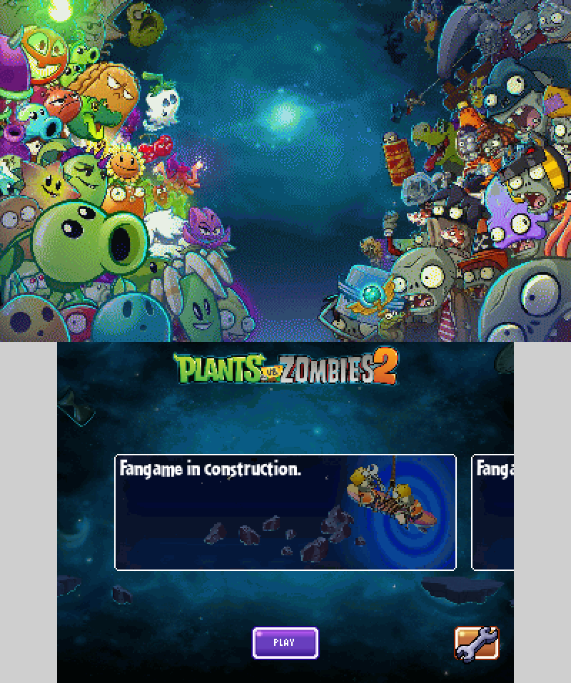
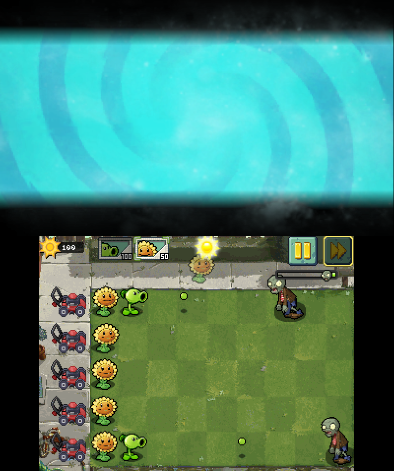

# Plants vs zombies 2 - 3DS edition
A little demake/port of PvZ2 on 3DS. Currently in developpement, for both old and new 3DS models.

there is only 1 level, for betatesters to play.

Features :

- Menu with buttons, carousel, play button, options with pages and checkboxes,
- Gameplay with peashooter and sunflower.
- Zombies types, with conehead, buckethead, flag and classic zombie.
- Pause menu, unfinished but it is here.
- Speedup button

Working on :

- The pause menu
- Shovel
- Plants of the tutorial
- Plant-food
- 3D support for top screen

