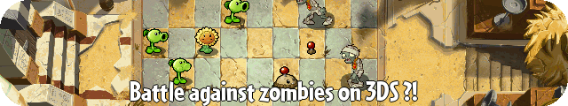

 

**Battle against zombies on 3DS, with a lot of new features !**

---

## ✨ About

**Plants vs zombies 2 - 3DS edition** is a project by Super_catGD to recreate the game from the ground up, and made it compatible with 3DS family consoles.

## 🚀 What can you do with this game ?

- ⚡ **It works on old 3DS** — Yeah, your old 3ds/2ds can run this game.
- 🎨 **Open source** — You can mod this game, but by giving up credits to me.
- 🧩 **New features** — I will add new plants, new zombies, and fanmade worlds ! So you, yes YOU, can help me by submitting ideas, or bugs.
- 🛠️ **Work in progress** — It's really not advanced, so wait for the future updates.

## 🧰 Technologies

- **The game engine :** The project is made with LovePotion3DS. An Löve port for 3DS families, and with a lot of capabilities !
- **The language :** The project is written in LUA, a basic language for everyone to mod the game !

## 📦 Installation

**1** - Click on releases and donwload the 3dsx file. Put it somewhere on your PC.
**2** - You can use WinSCP or another software on your PC and FTPD on 3DS to transfert your file, put it in the 3ds folder.
**3** - Open homebrew launcher, and play !

## 📦 Pack the game

**1** Put the downloaded game folder, icon.png and lovebrew.toml in the root of an zip file,
**2** Drag the zip file on the LovePotion Bundler Site Alt,
**3** Extract, and you have the game in 3dsx format.

## 🗺️ Dev notes

**SCENES :**
- [x] Menu
- [x] Gameplay
- [ ] Worldmap
- [ ] Shop

**PLANTS :**
- 100 % Player house plants.
- 0 % Ancient egypt plants.
- 0 % Pirate seas plants.
- 0 % Wild west plants.
 
**Zombies :**
- 80 % PlayerHouse zombies.
- 30 % Acient Egypt zombies.
- 0 % Pirate seas zombies.
- 0 % Wild west zombies.

**Options :**
- [x] Can disable shadows
- [x] Can disable particles
- [x] Can enable FPS HUD
- [x] Can go back to menu from the gameplay
- [x] Can go back to menu from the reward
- [x] Can go to the next level from the reward
- [ ] Can swap screens
- [ ] Can disable most plantfood optimisations

**Total worlds :**
- 90 % Player house finished.
- 5 % Ancient Egypt finished.
- 0 % Other worlds.

## 🖼️ Screenshots

---